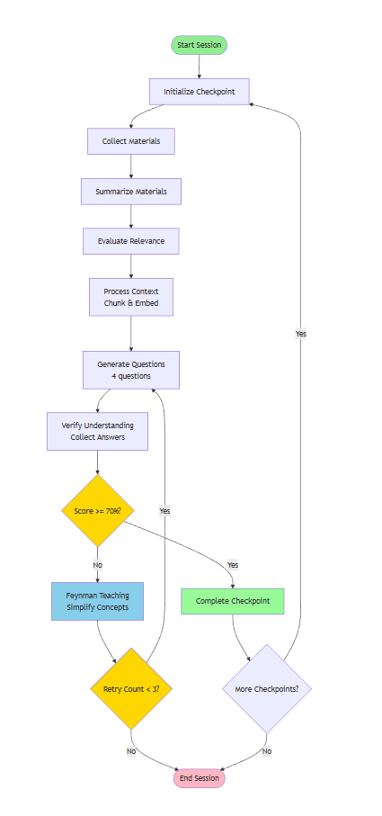
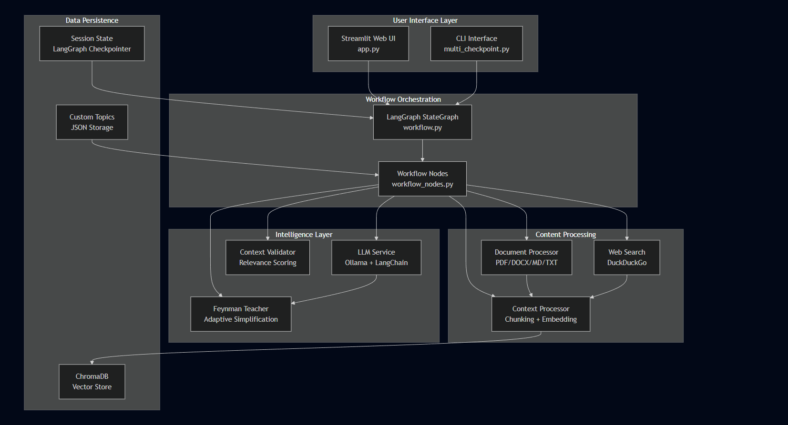
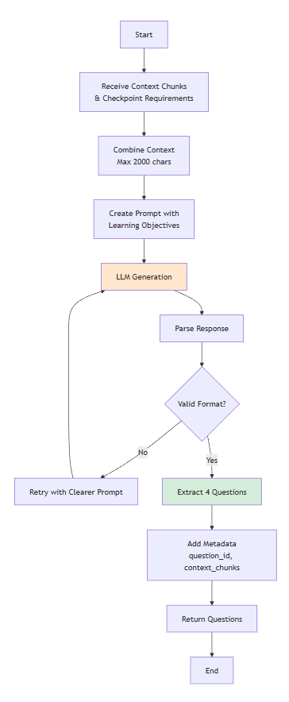
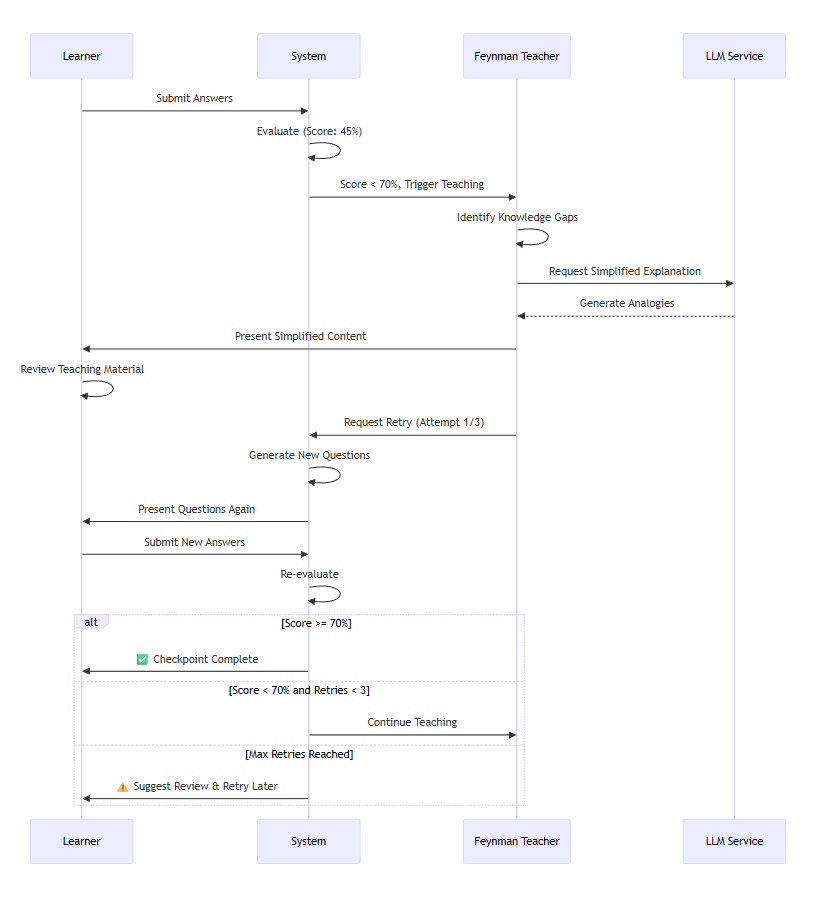
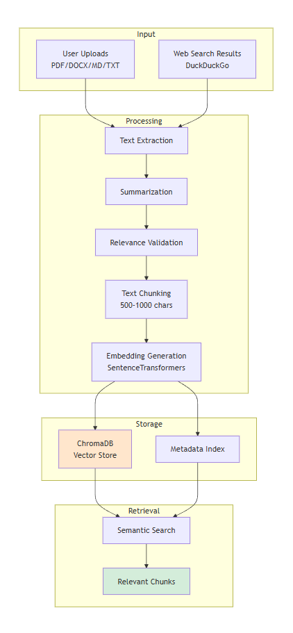
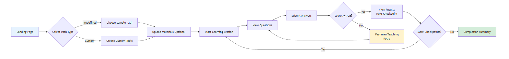

<div align="center">

# Learning Agent System

**An adaptive AI tutor that teaches in checkpoints, assesses in tiers, and re-teaches Feynman-style.**

Built with LangGraph · runs fully local on Ollama · Streamlit front end

[](https://www.python.org/)
[](https://streamlit.io/)
[](https://www.langchain.com/langgraph)
[](https://ollama.com/)
[](https://www.trychroma.com/)
[](LICENSE)

</div>

---

## ✨ What you get

| | | 
|---|---|
| 🛤️ **Structured paths** | Pick a curated path (or write your own topic) — each one is split into verified checkpoints |
| 📚 **Self-assembled materials** | Optionally upload your own notes (PDF · DOCX · MD · TXT), or let the agent research and draft study material for you |
| 🎯 **Tiered assessment** | Every checkpoint is graded with a strict mix: **5 multiple-choice · 3 short-answer · 2 long-answer** |
| ✅ **Honest scoring** | LLM-graded with a **70% pass threshold** — no hand-holding, no auto-pass |
| 🧠 **Feynman remediation** | Below the bar? The agent detects *which concept* broke down and re-teaches it in plain language |
| 🔍 **Fully observable** | Optional LangSmith tracing for every node, prompt, and LLM call |
| 💠 **Runs local & free** | Ollama handles the thinking on your machine — no paid API keys required |

---

## 🧭 The learning loop

The app walks every learner through the same five-stage loop — mirrored in the in-app workflow stepper:

<div align="center">

**Path** → **Materials** → **Study** → **Assessment** → **Results**

</div>

1. **Choose a path** — curated tracks with linked checkpoints (2-checkpoint paths keep sessions tight)
2. **Anchor materials** — upload notes (embedded into a local ChromaDB store) or skip: the agent searches the web, collects sources, and drafts a study pack
3. **Study** — read the material; the UI shows reading time and word count up front
4. **Assess** — 10 questions per checkpoint, mixed deliberately so recall *and* reasoning are tested
5. **Decide** — score ≥ 70% unlocks the next checkpoint; below that, the **Feynman process** kicks in:

> Detect the weakest concepts → explain them simply → let the learner re-attempt with a cleaner mental model.

<div align="center">
  
  <br/><em>The core loop: goal → materials → generation → verification</em>
</div>

---

## 🏗️ Under the hood

<div align="center">
  
  <br/><em>System architecture — LangGraph nodes wired around an Ollama LLM service</em>
</div>

<div align="center">
  
  <br/><em>Question generation — enforced 5/3/2 mix, context-aware, checkpoint-scoped</em>
</div>

<div align="center">
  
  <br/><em>Feynman process — gap detection then simplified re-teaching</em>
</div>

<details>
<summary>More diagrams (content pipeline · UI flow · Feynman process)</summary>

<div align="center">

| | |
|---|---|
|  |  |
| *Content processing pipeline* | *UI flow* |

|  |
|:---:|
| *Feynman teaching process* |

</div>
</details>

---

## 🛠️ Tech stack

| Layer | Tool | Why it's here |
|---|---|---|
| Orchestration | **LangGraph** | Deterministic, inspectable graph of learning nodes |
| LLM runtime | **Ollama** (`llama3.1`) | Local inference — private, free, offline-capable |
| Cloud fallback | **Hugging Face** (`zephyr-7b-beta`) | Auto-fallback when no local Ollama is reachable (handy for Streamlit Cloud) |
| Retrieval | **ChromaDB** + `all-MiniLM-L6-v2` | Embedding your uploaded notes for context-aware question generation |
| UI | **Streamlit** | The entire learning studio in one Python file |
| Observability | **LangSmith** | Tracing for every prompt and node — opt-in |
| Parsing | PyPDF2 · python-docx | PDF/DOCX ingestion |

---

## 🚀 Getting started

### Prerequisites

- **Python 3.10+**
- **[Ollama](https://ollama.com/)** installed and running locally

### 1 · Clone and install

```bash
git clone https://github.com/VaishnaviSingh-Analyst/Learning-Agent-System.git
cd Learning-Agent-System

python -m venv .venv
# Windows
.venv\Scripts\activate
pip install -r requirements.txt
```

### 2 · Pull a model

```bash
ollama pull llama3.1
```

### 3 · Configure

```bash
# .env — main configuration
copy .env.example .env            # Windows
# cp .env.example .env            # macOS / Linux

# .streamlit/secrets.toml — optional Streamlit-side secrets
copy .streamlit\secrets.toml.example .streamlit\secrets.toml
```

The defaults work out of the box with local Ollama. To use the Hugging Face fallback (e.g., for cloud deployment), set:

```env
LLM_PROVIDER=auto
HF_TOKEN=your_hf_token
HF_MODEL=HuggingFaceH4/zephyr-7b-beta
```

### 4 · Run

```bash
streamlit run app.py
```

or on Windows, start Ollama + Streamlit in one shot:

```powershell
powershell -ExecutionPolicy Bypass -File .\scripts\start_streamlit_with_ollama.ps1
```

Then open **http://localhost:8501**.

### 5 · Verify your setup (optional but smart)

```bash
python scripts/verify_setup.py
```

Runs **7 health checks**: dependencies, Ollama reachability, model availability, embeddings, vector store, LangSmith config, and Streamlit.

---

## 🔧 Configuration reference

All in `.env` (see `.env.example`):

| Variable | Default | Purpose |
|---|---|---|
| `LLM_PROVIDER` | `auto` | `auto` · `ollama` · `huggingface` |
| `OLLAMA_BASE_URL` | `http://localhost:11434` | Local Ollama endpoint |
| `OLLAMA_MODEL` | `llama3.1:latest` | Model used for generation & grading |
| `HF_MODEL` | `HuggingFaceH4/zephyr-7b-beta` | Fallback model |
| `HF_TOKEN` | *(empty)* | Avoids HF anonymous rate limits |
| `EMBEDDING_MODEL` | `sentence-transformers/all-MiniLM-L6-v2` | Embeddings for uploaded notes |
| `THRESHOLD` | `0.7` | Pass mark for checkpoints |
| `LANGSMITH_TRACING_ENABLED` | `false` | Set `true` to trace everything |
| `LANGCHAIN_API_KEY` | *(empty)* | LangSmith key (only if tracing) |
| `LANGCHAIN_PROJECT` | `Learning-Agent-System` | LangSmith project name |

### LangSmith tracing

```env
LANGSMITH_TRACING_ENABLED=true
LANGCHAIN_API_KEY=lsv2_...
LANGCHAIN_ENDPOINT=https://api.smith.langchain.com
# EU accounts: https://eu.api.smith.langchain.com
```

Restart Streamlit after changing them. The app shows live tracing status in the **LangSmith** panel.

---

## 🖥️ Two ways to drive it

| Mode | Command | Good for |
|---|---|---|
| 🎨 **Web UI** | `streamlit run app.py` | The full experience — paths, uploads, study packs, graded assessments |
| ⌨️ **CLI flow** | `python -m src.multi_checkpoint` | Quick checkpoint drills straight in the terminal |

---

## 📁 Project structure

```
Learning-Agent-System/
├── app.py                        # Streamlit UI — the learning studio
├── goal.json                     # Project goal definition & scope
├── requirements.txt
├── scripts/
│   ├── start_streamlit_with_ollama.ps1   # One-shot launcher (Windows)
│   └── verify_setup.py                   # 7-check environment health test
├── src/
│   ├── main.py                       # Pipeline entry point
│   ├── workflow.py                   # LangGraph graph wiring
│   ├── workflow_nodes.py             # Individual graph nodes
│   ├── llm_service.py                # Ollama / HF routing & fallback
│   ├── document_processor.py         # PDF · DOCX · MD · TXT ingestion
│   ├── dynamic_materials.py          # Web research → study packs
│   ├── context_processor.py          # Context preparation for questions
│   ├── context_validation.py         # Context sanity checks
│   ├── multi_checkpoint.py           # Question generation & CLI drills
│   ├── feynman_teaching.py           # Gap detection + simple re-teaching
│   ├── web_search.py                 # Source collection
│   ├── file_upload.py                # Upload handling
│   ├── custom_topics.py              # User-defined learning paths
│   ├── user_interaction.py           # CLI interaction helpers
│   ├── sample_data.py                # Built-in paths & samples
│   ├── models.py                     # Data models (paths, topics, results)
│   ├── langsmith_config.py           # Tracing setup
│   └── __init__.py
├── Flowcharts/                       # Visual architecture diagrams
└── LICENSE                           # MIT
```

---

## 🧪 Troubleshooting

| Symptom | Fix |
|---|---|
| **Ollama not reachable** | `ollama serve` in a terminal, then `ollama list` to confirm the model exists |
| **App starts, no AI responses** | Check Ollama is live on `http://localhost:11434` and `OLLAMA_MODEL` matches `ollama list` |
| **Hugging Face rate limits** | Set `HF_TOKEN` in `.env` |
| **Streamlit Community Cloud** | Local Ollama can't run there — use `LLM_PROVIDER=auto` + `HF_TOKEN`, or point `OLLAMA_BASE_URL` at a reachable remote Ollama |

---

## 📚 Deep dive

Full technical design, data flows, and module-by-module documentation live in **[Documentation.md](Documentation.md)**.

---

## License

[MIT](LICENSE) — built to be learned from, forked, and extended.

<div align="center">

*Teach → verify → re-teach. The Feynman way, automated.*

</div>
